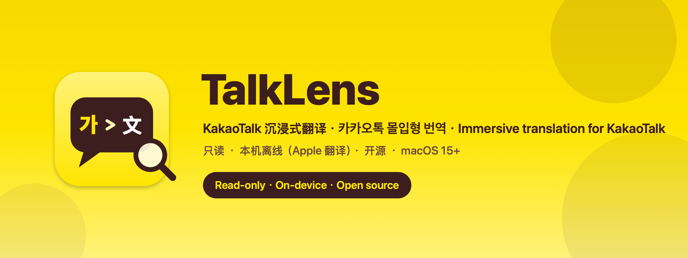
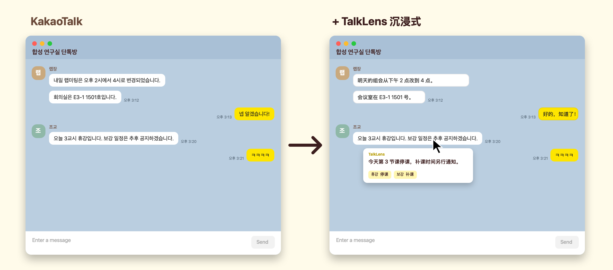

<div align="center">



**English** · [简体中文](README.zh-CN.md) · [한국어](README.ko.md)

<p>
  <a href="https://github.com/Amulopapa67/TalkLens/releases/latest/download/TalkLens.dmg"></a>
</p>

<p>
  
  
  
  
  <a href="LICENSE"></a>
</p>

**Read Korean group chats like they were written in your language.**<br>
TalkLens paints a translation right over every KakaoTalk bubble — on your Mac, offline, without touching a single message.

</div>

<br>

<p align="center">
  
</p>

> [!IMPORTANT]
> TalkLens is an **unofficial** project and is **not affiliated with Kakao Corp.**, nor endorsed or supported by it. "KakaoTalk" is a trademark of Kakao Corp., used here only to describe compatibility. TalkLens is **read-only**, may **stop working when KakaoTalk updates**, and is provided as is — **use at your own risk**.

## ✨ Features

| | |
|---|---|
| 🫧 **Immersive overlay** | Translations sit exactly on top of each bubble (yellow for yours, white for others) and follow scrolling, window moves and new messages. |
| 👀 **Original on demand** | Hover a bubble to reveal the original + a card with the translation and glossary notes. Hold **⌥ Option** to reveal everything. |
| 🪟 **Every chat window** | Group chats, 1:1, open chats and business channels — all open windows are translated at once; parts covered by other windows are left untouched. |
| 🌐 **Any language pair** | Source: Korean by default, smart auto-detect or a fixed language. Target: Simplified/Traditional Chinese, English, Japanese and more. App UI in 中文 / 繁體 / English / 한국어 / 日本語. |
| 📚 **Campus & lab glossary** | 랩미팅 = lab meeting/组会, 휴강 = class cancelled/停课, ㅋㅋ = lol … shown as chips, plus your own glossary. |
| 🔒 **Private by design** | Apple Translation runs on device. No network, no logs of message text, nothing written to disk. |
| 🖱️ **Never in the way** | The overlay is click-through: select, reply, react and type exactly as before. |

## 🚀 Install

**Option A — download the app** (recommended)

1. Download **[TalkLens.dmg](https://github.com/Amulopapa67/TalkLens/releases/latest/download/TalkLens.dmg)**, open it and drag **TalkLens** onto **Applications**.
2. First launch: **right-click TalkLens → Open** (the app is open source but not notarized by Apple, so macOS asks once).

**Option B — one line in Terminal**

```bash
curl -fsSL https://raw.githubusercontent.com/Amulopapa67/TalkLens/main/scripts/install.sh | bash
```

It downloads the latest release, verifies its SHA-256, installs it into Applications, removes the download quarantine flag and opens TalkLens.

**Then**

1. The onboarding window opens **System Settings → Privacy & Security → Accessibility** — switch **TalkLens** on. It works right away.
2. If asked, download the translation languages (one time, done by macOS).
3. Open any KakaoTalk chat. That's it. 🎉

<details>
<summary><b>Requirements</b></summary>

- macOS 15 Sequoia or later (macOS 26+ recommended for the lowest latency)
- KakaoTalk for Mac (tested with 26.8.0)
- Apple Silicon or Intel

</details>

## 🧭 Using TalkLens

- **Menu bar icon** — pause/resume, display mode (immersive / sidebar), languages, settings, onboarding, about.
- **Immersive mode** (default) — translations over bubbles; hover or hold ⌥ for the original.
- **Sidebar mode** — a docked list beside the chat window, if you prefer reading side by side.
- **Not machine-translated** — emoji-only messages, ㅋㅋ/ㅎㅎ-style shorthand (a note is shown instead), links, numbers, and messages already in your target language.
- **Settings** — source & target language, app language, display mode, font size, opacity, glossary, launch at login.

## 🔒 Privacy

TalkLens reads the text of chat windows that are **already open** through the macOS Accessibility API and translates it **on device**.

- The app makes **no network requests** (enforced by a guard script in CI). Only the optional installer downloads the release.
- Message text lives **in memory only**; the translation cache is cleared when you quit.
- Logs contain counts and timings — never message text or chat names. No telemetry.
- It never sends, clicks, types, scrolls, or touches KakaoTalk's network protocol, databases or caches; no injection, no private frameworks, no screen capture.

Details: [PRIVACY.md](PRIVACY.md).

## ❓ FAQ

<details>
<summary><b>macOS says the developer cannot be verified</b></summary>

Release builds are ad-hoc signed and not notarized (that requires a paid Apple Developer ID). Right-click the app → **Open**, or click **Open Anyway** at the bottom of System Settings → Privacy & Security. The one-line installer does this for you. You can also build from source.
</details>

<details>
<summary><b>Nothing is translated after an update</b></summary>

Ad-hoc signatures change between builds, so macOS treats the new version as a new app. In System Settings → Privacy & Security → Accessibility, switch TalkLens off and on again.
</details>

<details>
<summary><b>Older messages are not translated</b></summary>

TalkLens only sees messages KakaoTalk has loaded. Scroll up in KakaoTalk to load older history and it will be translated too.
</details>

<details>
<summary><b>Can it translate messages I send?</b></summary>

No — TalkLens is strictly read-only and never types into KakaoTalk.
</details>

## 🛠️ Build from source

Requires a Swift 6 toolchain (Xcode 16+ or the Command Line Tools).

```bash
swift build -c release
./scripts/build_app.sh          # build/TalkLens.app
./scripts/package_release.sh    # dist/TalkLens.dmg + dist/TalkLens.zip
swift test                      # unit, replay and translation-scheduler tests
```

Architecture: [docs/architecture.md](docs/architecture.md) · KakaoTalk AX structure (measured): [docs/ax-map.md](docs/ax-map.md) · design decisions: [docs/decisions.md](docs/decisions.md) · performance: [docs/PERF.md](docs/PERF.md)

## 📄 License & credits

MIT — see [LICENSE](LICENSE). Parts of `Sources/KakaoAX/` are derived from [kmsg](https://github.com/channprj/kmsg) (MIT, © 2026 Park Hee Chan), reduced to its read-only subset — see [THIRD_PARTY_NOTICES.md](THIRD_PARTY_NOTICES.md).

<div align="center"><sub>Made with ☕ for everyone learning to read Korean chats · not affiliated with Kakao</sub></div>
